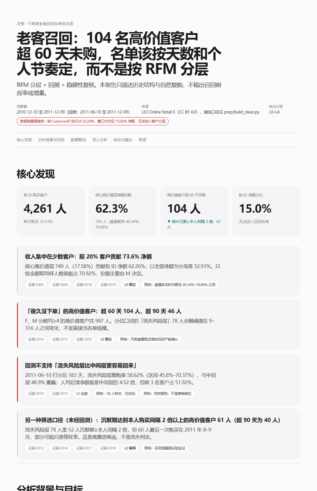
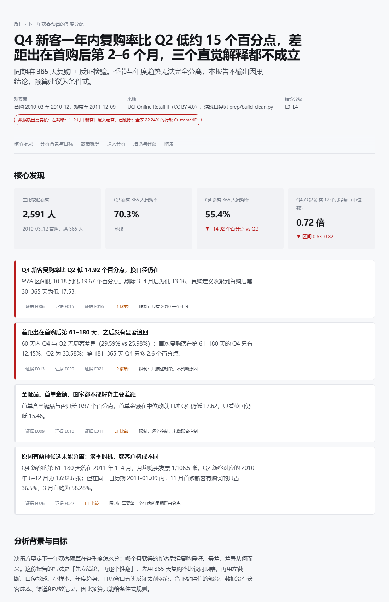

# 零售客户分析：用多智能体审查约束 AI 数据分析

用开源的 [data-analysis skill](https://github.com/xiaomaxueshufen/data-analysis)（作者：小马学数分，PolyForm Noncommercial 1.0.0），在 Claude Code 上对 UCI Online Retail II 真实交易数据（107 万行）做了两个客户侧分析。流程中派出真实并行的独立 subagent 做交叉审查，并用盲审对照实验量化 skill 的作用。过程中发现并修复了 skill 的两个缺陷。

> **归属说明**：skill 本身（`SKILL.md`、`scripts/`、`references/`）由原作者开发，不是本项目的工作。本项目是它的应用、评估和修补：分析问题、分析代码、审查编排、评估设计与缺陷修复。

## 做了什么

| # | 内容 | 产出 |
|---|---|---|
| 1 | **老客召回分析**：RFM 分层、半年回测、阈值敏感性与置信区间 | [报告](outputs/run1_rfm/report.html) · 15 条结论全部可溯源 |
| 2 | **新客同期群分析**：365 天复购、左截断处理、五类反证、条件式预算规则 | [报告](outputs/run2_cohort/report.html) · 14 条结论全部可溯源 |
| 3 | **多智能体审查**：每次分析并行派出 Locator / Mechanism / Falsifier 三个独立 subagent，互不读取对方输出，最后由 Reviewer 裁决 | `outputs/*/agents/*.json` |
| 4 | **盲审对照实验**：同一问题，不用 skill 的 subagent 也写一份报告，独立审稿人从原始数据复算打分 | [eval/](eval/README.md) |
| 5 | **上游缺陷修复**：RFM 算子打分方向反了；中文 Windows 下脚本输出崩溃 | [contrib/](contrib/) |

## 主要发现

**Run 1：老客召回**（[报告](outputs/run1_rfm/report.html)）
- 收入高度集中：前 20% 客户贡献 73.6% 的有 ID 净额。
- F、M 分数都高的 987 名高价值客户里，104 人超过 60 天没有下单。
- 回测不支持「流失风险层比中间层更容易回来」：流失风险层复购率 58.62%，95% 区间 45.8%–70.37%，和中间层重叠。所以召回名单改用「固定天数 + 沉默期 ≥ 本人历史购买间隔 2 倍」来筛。
- 召回实验的功效：104 人对半分，只能检出 26 个百分点的差异；要检出 10 个百分点，每组需要 389 人。

**Run 2：新客复购**（[报告](outputs/run2_cohort/report.html)）
- Q4 新客的 365 天复购率比 Q2 低 14.92 个百分点，区间 −19.67 到 −10.18。剔除 3–4 月、收紧复购定义后差距依然存在。
- 差距集中在首购后第 61–180 天，之后没有显著追回。三段拆分可以和总差距对账闭合。
- 三个直觉解释都说明不了这个差距：首单含圣诞商品、首单金额小、海外客户占比。
- 预算规则写成条件式：Q4 与 Q2 的单客获客成本之比高于 0.82 时，把 Q4 预算移走；低于 0.63 时维持 Q4 投放；落在两者之间先做测试。

## 多智能体审查拦下了什么

| | Reviewer 结论 | 典型拦截 |
|---|---|---|
| Run 1 | 14 条中 6 pass / 8 downgrade | 「个人节奏」信号只有一个独立观测，从 L2 降为 L1；召回 holdout 的对照组只有 8–9 人，功效不足，从 L3 降为 L2 |
| Run 2 | 第 1 轮 4 pass / 6 downgrade / **1 block** → 第 2 轮 0 block | 预算建议没有回答问题，还用「复购人数多」这种获客量效应来论证，被阻断；「淡季推迟」的解释与第 181–365 天没有追回相矛盾，改为两种未分离的候选 |

Falsifier 还发现了主分析的一个问题：4 名客户的净额只是浮点残差（约 1e-14），却被当作正值打分。已修正。

## 对照实验结果

| 组别 | 数字准确率 | 可复算率 | 越权结论 | 数据陷阱识别 |
|---|---|---|---|---|
| 用 skill | 88% | 88% | **0** | 9/12 |
| 不用 skill | 88% | 96% | **11** | 10/12 |

- 两组的数字一样准。差别在于不用 skill 的报告会把相关写成因果，还会在没有成本数据时给出精确的预算比例。
- 用 skill 的代价是口径写得不够全、建议不够直接。
- 样本只有 2 个问题，盲审也不完全盲，详见 [eval/README.md](eval/README.md)。

## 给 skill 的修复

1. **RFM 算子方向反了**（[patch](contrib/fix-rfm-score-direction.patch)）：`rank(ascending=...)` 的方向写反，最近下单、下单最频繁、金额最高的客户被标成 `dormant`。在本数据上，修复前「沉睡」层占 45.5% 的金额。同时把并列值的处理从 `first` 改为 `average`：35% 的客户只买过 1 次，原来的写法会按行序把他们任意拆进不同档。新增 2 个回归测试，两个测试在修复前的代码上都会失败。
2. **中文 Windows 下管道输出崩溃**（[patch](contrib/fix-gbk-stdout.patch)）：GBK 编码写不出「✓」，`da_reconcile` 在结果文件已经写好后以退出码 1 结束，调用方会误判为对账失败。
3. **数据说明勘误**：skill 自带案例写「完全重复行 34,039 行（3.23%）」，其中 22,245 行其实是两个 Excel sheet 在 2010-12-01..09 的重叠，真正的重复记录只有 11,794 行。清洗结果不受影响（见 `data/clean_log.json`）。

修复后 skill 测试套件 76/76 通过。

## 目录

```text
prep/build_clean.py          清洗（与 skill 案例同一口径，结果逐位一致：1,021,333 行 / 净额 18,928,551.86）
outputs/run1_rfm/            Run 1：analysis.py → robustness.py → build_evidence.py → claims.json → report.html
outputs/run2_cohort/         Run 2：同上
outputs/*/agents/            四角色 subagent 工件 + execution.json（记录真实 agent id 与派发顺序）
outputs/*/da_verify.json     真实性检查结果（数字溯源、层级、角色工件）
eval/                        对照实验：对照组报告、盲审评分规则与结果
contrib/                     给 skill 的补丁
docs/img/                    报告截图
```

## 复现

```bash
pip install pandas numpy openpyxl
# 1. 从 UCI 下载 online_retail_II.xlsx，把两个 sheet 另存为 data/Year_2009-2010.csv、data/Year_2010-2011.csv
python prep/build_clean.py
# 2. 每个 run 目录按顺序执行（需要已安装 data-analysis skill 并应用 contrib/ 中的补丁）
cd outputs/run1_rfm
python analysis.py && python robustness.py && python build_evidence.py && python build_report_spec.py
python ~/.claude/skills/data-analysis/scripts/da_verify.py --claims claims.json --evidence evidence.json --reconciliation 02_reconcile.json --agents-dir agents --require-agent-manifest
python ~/.claude/skills/data-analysis/scripts/da_report.py --spec report_spec.json --out report.html
```

四角色审查需要在 Claude Code 中按 skill 的 `references/harness.md` 派发 subagent，不能用脚本复现。

## 截图

| Run 1 | Run 2 |
|---|---|
|  |  |

## 数据与许可

- 数据：[UCI Online Retail II](https://archive.ics.uci.edu/dataset/502/online+retail+ii)，CC BY 4.0。原始数据不入库。
- skill：PolyForm Noncommercial 1.0.0，仅限非商业用途；本项目的补丁同样遵循该许可。
